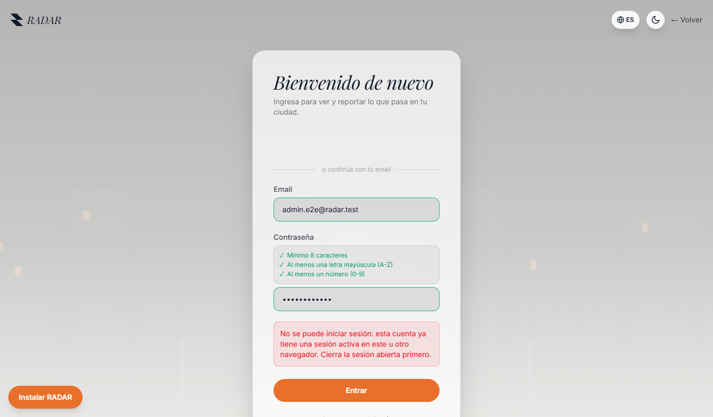
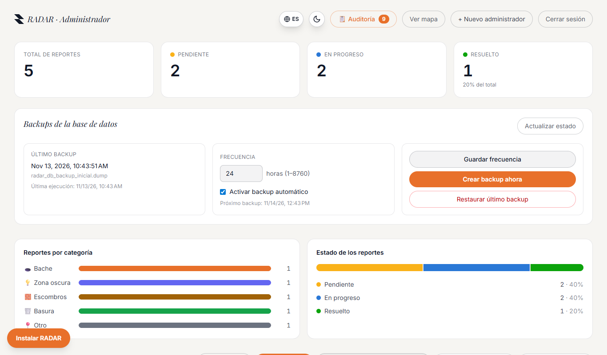
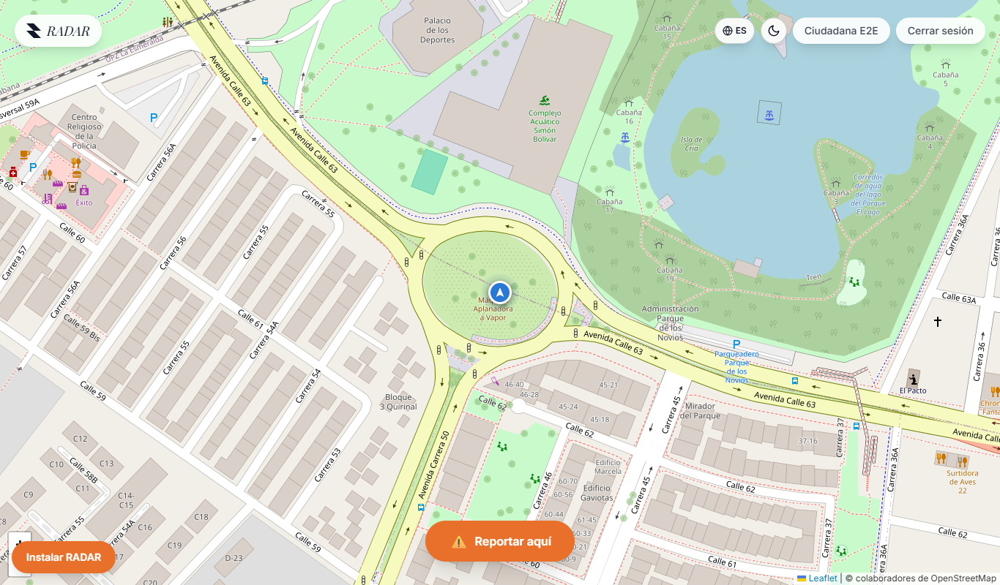
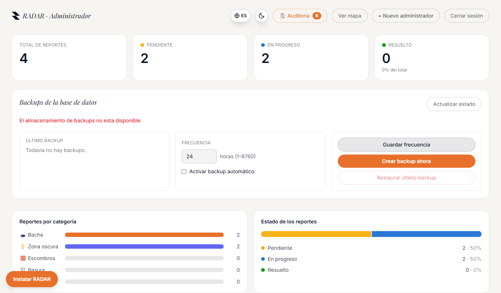
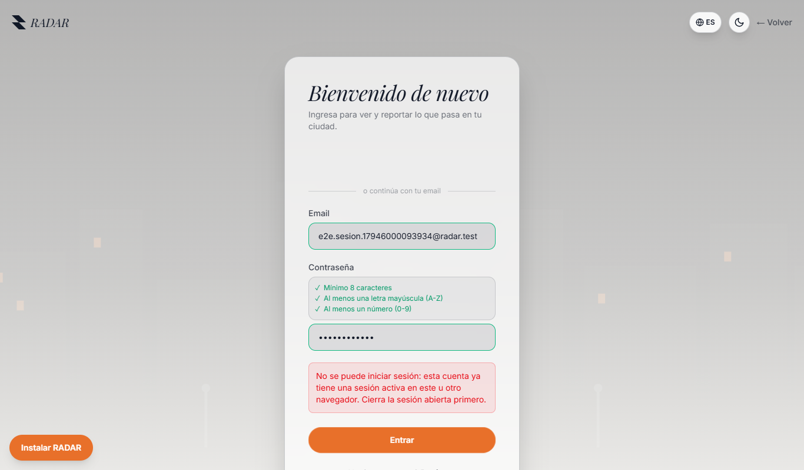
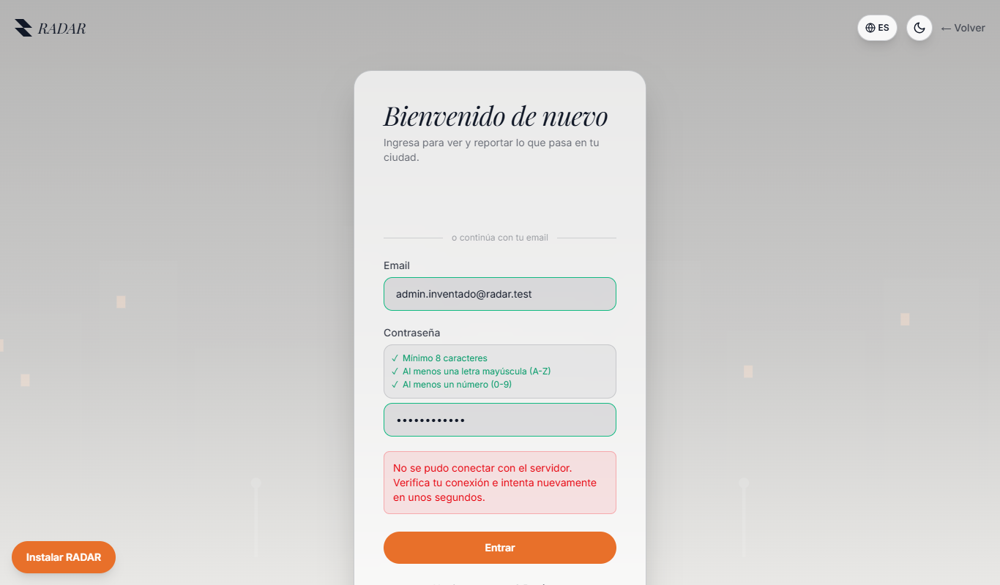

[Nombre de la institución]

[Programa académico]

<strong>RADAR</strong>

<strong>Informe técnico de auditoría, pruebas de software y corrección de defectos</strong>

[Autor 1] [Autor 2] [Autor 3]

[Asignatura]

[Nombre del docente]

[Ciudad]

[Fecha de presentación]

# Resumen

Este informe documenta la auditoría técnica, el proceso de pruebas y la corrección de defectos de RADAR, una plataforma web para el reporte ciudadano de problemas de infraestructura urbana construida con Spring Boot 3.5.6 (Java 21), Angular 21 y PostgreSQL 16. El trabajo se realizó sobre el último commit de la rama principal (`e9e1021`) y se organizó en dos ciclos. En el ciclo de detección se reparó la suite de pruebas original, que fallaba en 14 de sus 26 pruebas, y se ejecutaron 126 casos de caja blanca, caja negra y extremo a extremo (E2E): 98 fueron aprobados y 28 fallaron. Los fallos revelaron 14 defectos reales en el código vigente, y la herramienta SST 2.0 del product owner señaló uno más: la ausencia de cabeceras de seguridad HTTP. Los dos más graves eran que, en la versión de `main`, **ningún usuario podía iniciar sesión desde la interfaz**, y que, si el servidor no respondía, el frontend **concedía acceso, incluso de administrador, con credenciales inventadas** y guardaba las contraseñas en texto plano en el navegador. Los 15 defectos se corrigieron en el backend y el frontend sin alterar la arquitectura. En el ciclo de regresión se ejecutaron 139 casos y todos fueron aprobados, al igual que la verificación de los defectos por HTTP contra PostgreSQL real. El workflow de integración continua creado en GitHub Actions se ejecutó en los servidores de GitHub y terminó con éxito. Con SST 2.0, los hallazgos de severidad media y baja pasaron de 6 a 0; solo quedan indicadores informativos que se verificaron como falsos positivos. Los 8 casos pendientes corresponden a una propuesta de pruebas para OpenRouter, que RADAR no integra. La cobertura de ramas del backend alcanzó el 56,6 %.

*Palabras clave:* pruebas de software, corrección de defectos, pruebas de regresión, integración continua, GitHub Actions, pruebas de extremo a extremo, caja blanca, caja negra, seguridad de aplicaciones.

# Introducción

RADAR permite a la ciudadanía reportar sobre un mapa problemas de infraestructura urbana, como baches, zonas oscuras, escombros o basura, y a un equipo administrador gestionar el ciclo de vida de esos reportes. El sistema maneja datos personales, autenticación con sesión única por usuario, auditoría de acciones administrativas y copias de seguridad. Por ello, sus defectos afectan directamente la disponibilidad, la integridad de la información y la confianza de los usuarios.

La integración continua, entendida como la práctica de integrar cambios con frecuencia y verificar cada integración mediante una construcción y pruebas automatizadas (Fowler, 2024), reduce el tiempo entre la introducción de un defecto y su detección. Sin embargo, detectar defectos es solo la mitad del aseguramiento de la calidad: la otra mitad consiste en corregirlos y demostrar, mediante pruebas de regresión, que la corrección funciona y que no rompe lo que ya funcionaba.

Este documento presenta ambas mitades sobre el código vigente del proyecto y distingue en todo momento las pruebas ejecutadas de las que solo se diseñaron.

# Objetivos

## Objetivo general

Evaluar y mejorar la calidad de RADAR mediante pruebas de integración continua, de extremo a extremo, de caja blanca y de caja negra, corregir los defectos encontrados y verificar las correcciones con pruebas de regresión trazables.

## Objetivos específicos

1. Diagnosticar la arquitectura, las tecnologías y el estado de las pruebas existentes en el commit vigente.
2. Configurar y ejecutar en GitHub un flujo de integración continua compatible con las tecnologías del proyecto.
3. Diseñar y ejecutar pruebas E2E, de caja blanca y de caja negra sobre las funcionalidades principales.
4. Determinar si RADAR integra la API de OpenRouter y, si no lo hace, proponer un plan de pruebas para una integración futura.
5. Corregir los defectos detectados sin alterar la arquitectura del sistema.
6. Verificar las correcciones con pruebas de regresión automatizadas, contra PostgreSQL real y con un navegador real.

# Alcance

La evaluación se realizó sobre el commit `e9e1021` de `main` ("asegurar candado de sesión única entre navegadores"), que incluye los cambios del equipo sobre la política de contraseñas y la sesión única estricta. Las pruebas y correcciones se entregan en la rama `qa/auditoria-pruebas-y-correcciones`, publicada en el repositorio remoto. Se evaluaron el backend (controladores, servicios, seguridad, manejo de excepciones y repositorios), el frontend (autenticación, mapa, panel de administración, backups y cierre de sesión) y la integración continua.

Quedaron fuera del alcance la ejecución real de copias de seguridad, la validación de tokens reales de Google y reCAPTCHA, las pruebas de rendimiento y la compatibilidad con navegadores distintos de Google Chrome.

Una auditoría preliminar se había realizado sobre una copia de trabajo con cambios locales que el equipo decidió descartar, porque el commit `e9e1021` ya los corregía. Ese material no forma parte de este informe y se conservó fuera del repositorio solo por trazabilidad.

**Tabla 1**

*Archivos modificados o creados en la rama de la auditoría*

| Área | Archivo | Propósito |
|---|---|---|
| Backend: corrección | `AuthService`, `AuthController`, `UserDetailsServiceImpl`, `AdminService` | DEF-01, 02, 09, 10, 11, 13 y 15 |
| Backend: corrección | `UserRepository`, `AdministradorRepository` | Unicidad del correo sin distinguir mayúsculas |
| Backend: corrección | `GlobalExceptionHandler` | DEF-03, DEF-04 y registro de errores |
| Backend: corrección | `ReportController`, `AuditLogController`, `AdminSeeder` | DEF-05, DEF-07 y DEF-08 |
| Frontend: corrección | `auth.service.ts`, `admin.service.ts`, `report.service.ts`, `backup.service.ts`, `environment*.ts` | DEF-12, DEF-14 y la parte cliente de DEF-10, 11 y 13 |
| Pruebas | `backend/src/test/**`, `backend/pom.xml` | Suite reparada, caja blanca, caja negra, E2E de API, H2 y JaCoCo |
| Pruebas | `e2e/` | E2E con Playwright, verificación de defectos por HTTP y generación del informe |
| CI | `.github/workflows/ci.yml` | Workflow de integración continua |
| Documentación | `docs/` | Informe y evidencias |

*Nota.* Las rutas del backend son relativas a `backend/src/main/java/com/radar/api/`, y las del frontend a `frontend/src/app/core/services/`.

# Descripción técnica del proyecto

## Arquitectura

RADAR sigue una arquitectura cliente-servidor de tres capas. El frontend es una aplicación de página única (SPA) en Angular que consume una API REST. El backend organiza el código en controladores, servicios, repositorios Spring Data JPA y entidades de PostgreSQL. La seguridad es sin estado: cada petición lleva un JSON Web Token (JWT) cuyo identificador de sesión debe coincidir con la sesión activa del usuario.

En `e9e1021` la sesión única es **estricta**: una segunda sesión se rechaza siempre, sin opción de forzarla, hasta que la primera cierre sesión o pasen 30 segundos sin actividad. Para ello el backend mantiene un registro de sesiones en memoria, y el frontend usa además un "candado entre navegadores" (`/api/auth/session-lock`) con el que cada pestaña reclama y renueva su derecho a usar la cuenta.

## Tecnologías y herramientas

**Tabla 2**

*Tecnologías identificadas y herramientas de prueba*

| Capa | Tecnología | Versión |
|---|---|---|
| Backend | Spring Boot (web, data-jpa, security, validation), Java | 3.5.6, Java 21 |
| Backend | jjwt / Google API Client / Azure Storage Blob | 0.12.6 / 2.7.2 / 12.30.0 |
| Datos | PostgreSQL | 16 |
| Frontend | Angular / TypeScript / Vitest | 21.2 / 5.9 / 4.1 |
| Despliegue | Docker, Render (backend), Vercel (frontend) | — |
| Pruebas | JUnit 5, Mockito, MockMvc, H2, JaCoCo, Playwright | JaCoCo 0.8.14; Playwright 1.56.1 |
| CI | GitHub Actions (checkout, setup-java y setup-node `v5`; upload-artifact `v6`) | — |

## Componentes y funcionalidades principales

**Tabla 3**

*Módulos del backend y su responsabilidad*

| Módulo | Endpoints | Responsabilidad |
|---|---|---|
| `AuthController` / `AuthService` | `/api/auth/register`, `/login`, `/google`, `/heartbeat`, `/logout`, `/session-lock` | Registro, autenticación, sesión única estricta y candado entre navegadores |
| `ReportController` / `ReportService` | `/api/reportes` y subrutas | Reportes de ciudadanos y gestión por administradores |
| `AdminController` / `AdminService` | `/api/admin/administradores` | Alta de administradores |
| `AuditLogController` | `/api/admin/auditoria` | Registro y consulta de auditoría |
| `BackupController` / `BackupService` | `/api/admin/backups` y subrutas | Copias de seguridad de PostgreSQL |
| `GlobalExceptionHandler` | — | Traducción de excepciones a respuestas HTTP |

## Diagnóstico inicial

1. **Línea base.** La suite original, con 26 pruebas, terminó en `e9e1021` con 4 fallos y 10 errores (Figura 1). Las causas eran pruebas desactualizadas: contraseñas que ya no cumplían la nueva política, el escenario de "forzar ingreso" que la especificación eliminó, y dependencias no simuladas (`AuditLogService`).
2. **Integración continua.** No existía ningún workflow.
3. **OpenRouter.** No hay ninguna integración con OpenRouter ni con otros proveedores de modelos de lenguaje.
4. **Riesgos por inspección de código.** Se identificaron: el manejo de errores genérico (todo responde 500); la unicidad incompleta del correo; endpoints públicos que modifican el estado de sesión de cualquier cuenta; y, en el frontend, un modo de autenticación simulada que se activa cuando el backend no responde.

<figure>
<pre class="evidencia">[ERROR] Tests run: 26, Failures: 4, Errors: 10, Skipped: 0
AuthServiceTest.rejectsLoginWhenSessionIsAlreadyActive  -> IllegalArgumentException
AdminServiceTest.registersAdministratorWithEncodedPassword -> "La contrasena debe tener minimo 8 caracteres..."
ReportServiceTest.createsReportForExistingAuthor -> NullPointer ... "this.auditLogService" is null</pre>
<figcaption><strong>Figura 1</strong> <em>Línea base de la suite original sobre el commit e9e1021</em> <em>Nota.</em> Extracto de <code>docs/evidencias/00-linea-base/backend-suite-original-e9e1021.txt</code>.</figcaption>
</figure>

# Metodología

El trabajo siguió seis etapas: (a) actualización al commit vigente y línea base; (b) reparación de la suite original según la especificación vigente; (c) diseño de pruebas; (d) **ciclo 1, de detección**, sobre el código de `e9e1021` sin modificar; (e) corrección de defectos; y (f) **ciclo 2, de regresión**, sobre el código corregido. Cada defecto se confirmó con al menos una prueba que falla en `e9e1021` y pasa tras la corrección.

Las **pruebas de caja blanca** se derivaron de la estructura del código: decisiones, condiciones y ramas de los métodos críticos, con cobertura medida con JaCoCo (JaCoCo, s.f.). Las **pruebas de caja negra** se derivaron solo de la especificación (contratos HTTP, validaciones y reglas de negocio), aplicando partición de equivalencia, análisis de valores límite y tablas de decisión. La caja blanca pregunta si cada camino del código se comporta bien; la caja negra, si el sistema responde lo esperado ante cada clase de entrada.

Las pruebas de API usan JUnit 5 (JUnit Team, s.f.) y MockMvc sobre la aplicación completa (VMware Tanzu, s.f.), con H2 en modo PostgreSQL para poder ejecutarse en integración continua. Los defectos se verificaron además por HTTP contra PostgreSQL 16 con un script reproducible (`e2e/scripts/verificar-defectos-api.sh`). Las pruebas E2E usan Playwright Test (Microsoft, s.f.) con Google Chrome contra el stack completo: el contenedor del frontend definido en `compose.yaml`, el backend y una base PostgreSQL desechable. Las tablas siguen las pautas de la séptima edición de APA (American Psychological Association, s.f.).

**Aislamiento de defectos del frontend.** En `e9e1021` nadie puede iniciar sesión desde la interfaz (DEF-13). Para comprobar por separado el defecto DEF-14 del frontend, las pruebas E2E-12 y E2E-13 se ejecutaron con el frontend original y el backend corregido.

**Tabla 4**

*Entorno de ejecución*

| Elemento | Valor |
|---|---|
| Sistema operativo / JDK local | Windows 11 Pro / Temurin 25.0.4.1 (el CI usa Temurin 21) |
| Node.js / npm | 24.21.0 / 11.19.0 |
| Navegador E2E | Google Chrome (canal `chrome` de Playwright) |
| Stack E2E | Frontend `radar-frontend-1` en el puerto 4200, backend en 8080 y PostgreSQL 16 desechable en 5440 |
| Integración continua | Runners `ubuntu-latest` de GitHub Actions |
| Fecha | 13 de noviembre de 2026 |

# GitHub Actions

## Configuración

El workflow `.github/workflows/ci.yml` (**CI RADAR**) se ejecuta en cada `push` y en cada *pull request* hacia `main`, según la sintaxis oficial de GitHub (GitHub, s.f.). Su job `backend` ejecuta `./mvnw -B verify` (compilación, pruebas y cobertura), publica un resumen y artefactos, y corre un paso informativo para pruebas etiquetadas como `known-defect`. Su job `frontend` ejecuta `npm ci`, las pruebas con Vitest y el build de producción.

## Resultados

El workflow **se ejecutó en los servidores de GitHub** al publicar la rama. La primera ejecución terminó con éxito, pero dejó avisos: acciones que corrían sobre Node.js 20, ya obsoleto, y un artefacto vacío. Se actualizaron las acciones y la tercera ejecución terminó **con éxito y sin advertencias de configuración** (Figura 2).

**Tabla 5**

*Casos de prueba de integración continua*

| ID | Caso | Resultado | Estado |
|---|---|---|---|
| GA-01 | Validación estática del YAML (35 verificaciones) | 35/35 | Aprobada |
| GA-02 | Simulación local del job `backend` | 166 pruebas, 0 fallos; `BUILD SUCCESS` | Aprobada |
| GA-03 | Simulación local del job `frontend` (`npm ci` real) | 610 paquetes; 1/1 prueba; build correcto | Aprobada |
| GA-04 | Paso informativo `known-defect` | 0 pruebas etiquetadas; paso en verde | Aprobada |
| GA-05 | Ejecución real en GitHub Actions | 3 ejecuciones `success`; la definitiva sin advertencias | Aprobada |

<figure>
<pre class="evidencia">run_id: 43500669028 | commit: 997e98b | evento: push | conclusion: success
JOB: Frontend (Angular) - pruebas y build -> success (30s) | pasos propios: 6, todos success
JOB: Backend (Spring Boot) - build, pruebas y cobertura -> success (78s) | pasos propios: 9, todos success
ARTEFACTOS: backend-reportes (433 KB), frontend-dist (766 KB)
url: https://github.com/jexxch66-cell/radar/actions/runs/43500669028</pre>
<figcaption><strong>Figura 2</strong> <em>Ejecución definitiva del workflow CI RADAR en GitHub Actions</em> <em>Nota.</em> Datos obtenidos de la API pública de GitHub; registro completo en <code>docs/evidencias/01-github-actions/ejecucion-real-github-actions.txt</code>.</figcaption>
</figure>

# Pruebas E2E

Se implementaron 13 escenarios con navegador real y 4 flujos encadenados a nivel de API. Los escenarios cubren a los tres actores (visitante, ciudadano y administrador) y las reglas vigentes: política de contraseñas, sesión única estricta y seguridad e integridad ante fallos del servidor.

**Tabla 6**

*Casos de prueba E2E en ambos ciclos*

| ID | Escenario | Ciclo 1 (`e9e1021`) | Ciclo 2 (corregido) |
|---|---|---|---|
| E2E-01 a 04 | Portada, redirección del *guard*, página 404, login inválido | Aprobadas | Aprobadas |
| E2E-05 | Registro por la interfaz y primer login | **Fallida**: no entra (DEF-13) | Aprobada |
| E2E-06 | El ciudadano crea un reporte desde el mapa | **Fallida**: no entra (DEF-13) | Aprobada |
| E2E-07 | El administrador cambia el estado de un reporte | **Fallida**: no entra (DEF-13) | Aprobada |
| E2E-08 | Sesión única estricta en dos navegadores | **Fallida**: no entra (DEF-13) | Aprobada |
| E2E-09 | Cierre de sesión | **Fallida**: no entra (DEF-13) | Aprobada |
| E2E-10 | Con el backend caído, credenciales inventadas no dan acceso | **Fallida**: entra como ADMIN (DEF-12) | Aprobada |
| E2E-11 | La contraseña no queda en el navegador | **Fallida**: queda en texto plano (DEF-12) | Aprobada |
| E2E-12 | Error del servidor al crear un reporte | **Fallida**: simula la publicación (DEF-14) | Aprobada |
| E2E-13 | Error del servidor al crear un backup | **Fallida**: muestra un backup inexistente (DEF-14) | Aprobada |
| E2E-API-01 a 04 | Ciclo del ciudadano, gestión con auditoría, sesión estricta, alta de administrador | Aprobadas | Aprobadas |

*Nota.* Ciclo 1: 8 aprobadas y 9 fallidas. Ciclo 2: 17/17 aprobadas. Evidencias en `docs/evidencias/02-e2e/`.

<figure>

<figcaption><strong>Figura 3</strong> <em>Ciclo 1: en e9e1021 el administrador no puede iniciar sesión desde la interfaz (DEF-13)</em> <em>Nota.</em> El backend registró el login como exitoso, pero el frontend descartó la sesión al fallar el reclamo del candado de su propia pestaña. Lo mismo ocurre con cualquier usuario.</figcaption>
</figure>

<figure>

<figcaption><strong>Figura 4</strong> <em>Ciclo 1: con el backend caído, unas credenciales inventadas dan acceso al panel de administrador (DEF-12)</em> <em>Nota.</em> Correo "admin.inventado@radar.test". Las cifras y el backup que se muestran son datos simulados por el frontend (DEF-14).</figcaption>
</figure>

<figure>

<figcaption><strong>Figura 5</strong> <em>Ciclo 1: el servidor responde 503, pero el panel informa "Backup creado" (DEF-14)</em> <em>Nota.</em> Frontend original de e9e1021. Un administrador podría creer protegida una base de datos que no lo está.</figcaption>
</figure>

<figure>

<figcaption><strong>Figura 6</strong> <em>Ciclo 2: la ciudadana recién registrada inicia sesión y llega al mapa</em> <em>Nota.</em> Captura de Playwright. Teselas de mapa © colaboradores de OpenStreetMap.</figcaption>
</figure>

<figure>

<figcaption><strong>Figura 7</strong> <em>Ciclo 2: ante el mismo error 503, el panel informa el problema real</em> <em>Nota.</em> Captura de Playwright tras la corrección de DEF-14.</figcaption>
</figure>

# Integración con OpenRouter

OpenRouter es una API unificada que da acceso a cientos de modelos de inteligencia artificial mediante un único *endpoint* (OpenRouter, s.f.-d). La búsqueda en el código, la configuración y las dependencias no encontró ninguna referencia a OpenRouter ni a otros proveedores. **RADAR no integra OpenRouter**, por lo que no se implementó una integración artificial.

Se propone el plan de la Tabla 7, basado en la documentación oficial. La API se autentica con `Authorization: Bearer` sobre `https://openrouter.ai/api/v1` (OpenRouter, s.f.-a). Sus errores usan los códigos 400, 401, 402, 403, 408, 429, 502 y 503 (OpenRouter, s.f.-b). Las respuestas 429 pueden incluir la cabecera `Retry-After` (OpenRouter, s.f.-c).

**Tabla 7**

*Casos propuestos para una futura integración con OpenRouter (no ejecutados)*

| ID | Objetivo | Resultado esperado |
|---|---|---|
| OR-01 | Solicitud exitosa con clave de pruebas | 200 y respuesta parseable |
| OR-02 | Credenciales inválidas | 401 sin reintentos y sin exponer la clave |
| OR-03 | Solicitud incompleta | 400 con mensaje controlado |
| OR-04 | Respuesta inesperada (servidor simulado) | Degradación a clasificación manual |
| OR-05 | Errores 402, 502 y 503 (servidor simulado) | Degradación controlada y registro |
| OR-06 | Límite de solicitudes (429 con `Retry-After`) | Reintento con retroceso exponencial |
| OR-07 | Tiempo de respuesta | Percentil 95 dentro del umbral |
| OR-08 | Manejo de secretos | La clave nunca aparece en logs ni en el repositorio |

# Pruebas de Caja Blanca

## Diseño y casos

Las pruebas se derivaron del código de `e9e1021`. La Tabla 8 resume los grupos y su relación con las decisiones del código.

**Tabla 8**

*Grupos de pruebas de caja blanca*

| Grupo | Casos | Decisiones y condiciones cubiertas | Resultado final |
|---|---|---|---|
| Política de contraseñas (CB-POL) | 2 (9 ejecuciones) | Expresión regular: longitud, mayúscula, número, nulo y vacío | Aprobadas |
| Registro en memoria y candado (CB-MEM, CB-LCK) | 9 | Ramas `claim`, `check`, `heartbeat` y `release`, expiración de 30 s, separación de mapas (CB-LCK-07/08) | Aprobadas |
| Login (CB-AUTH) | 9 | Política antes de autenticar, sesión en memoria o en BD, ventana de 29/31 s, `force` ignorado, rama de administrador, `requireSessionUpdated` | Aprobadas |
| Registro (CB-REG) | 5 | Política, reCAPTCHA, token válido del registro, correo de administrador, normalización | Aprobadas tras la corrección |
| Google, heartbeat y logout (CB-GGL, CB-HB, CB-OUT) | 6 | Consentimiento, sesión activa, correo de administrador, renovación y liberación | Aprobadas |
| JWT, filtro, reCAPTCHA, Google y auditoría (CB-JWT, CB-FIL, CB-CAP, CB-GOO, CB-AUD) | 16 | Firma, expiración, sesión reemplazada, cabeceras y valores por defecto | Aprobadas |
| Suite original reparada y regresión de `UserDetailsServiceImpl` (CB-UDS-01) | 27 | Servicios de autenticación, reportes, backups y JWT | Aprobadas |

*Nota.* 74 casos y 91 ejecuciones unitarias. En el ciclo 1 se ejecutaron 67 casos, de los que fallaron 2 (CB-REG-03 y `registersUserAndReturnsToken`), ambos por DEF-09. Los 7 casos restantes se añadieron en el ciclo 2 como regresión.

## Cobertura de código

**Tabla 9**

*Cobertura del backend medida con JaCoCo*

| Medición | Ejecuciones | Instrucciones | Ramas |
|---|---|---|---|
| Ciclo 1: suite completa sobre `e9e1021` | 156 | 64,8 % (2 525/3 896) | 53,4 % (158/296) |
| Ciclo 2: solo pruebas unitarias (antes de DEF-16) | 91 | 45,4 % (1 871/4 118) | 42,4 % (134/316) |
| Ciclo 2: suite completa (con DEF-16) | 166 | 66,1 % (2 736/4 137) | 56,6 % (179/316) |

*Nota.* Builds limpios (`mvnw clean verify`). En el ciclo 2, `AuthService` alcanza el 84,7 % de ramas, `AuthController` el 71,4 % y `GlobalExceptionHandler` el 75,0 %. Reportes en `docs/evidencias/04-caja-blanca/`.

# Pruebas de Caja Negra

## Diseño

Se aplicó partición de equivalencia y análisis de valores límite a la contraseña (7 y 8 caracteres, sin mayúscula, sin número), las coordenadas (límites y ±0,0001), la descripción (0, 1, 500 y 501 caracteres), el intervalo de backup (0, 1, 8760 y 8761) y la categoría. La sesión única estricta se modeló con la Tabla 10.

**Tabla 10**

*Tabla de decisión de la sesión única estricta*

| Regla | ¿Sesión activa? | `force` | Acción esperada | Resultado |
|---|---|---|---|---|
| R1 | No | — | 200 | Conforme |
| R2 | Sí | `false` | 409 | Conforme |
| R3 | Sí | `true` | 409 (bloqueo estricto) | Conforme |
| R4 | No, tras cerrar sesión | — | 200 | Conforme |

## Resultados

**Tabla 11**

*Casos de caja negra que evidenciaron defectos*

| ID | Entrada | Esperado | Ciclo 1 | Ciclo 2 | Defecto |
|---|---|---|---|---|---|
| CN-05 | Correo duplicado en MAYÚSCULAS | 409 | 201 (segunda cuenta) | 409 | DEF-02 |
| CN-06 / 06b | Ciudadano con el correo de un administrador | 409; el administrador conserva su acceso | 201; el administrador recibe 401 | 409; 200 | DEF-01 |
| CN-07, 21, 22, 24 | JSON mal formado, enum inválido, tipo erróneo, id no numérico | 400 | 500 | 400 | DEF-03 |
| CN-31, 34 | Ruta inexistente; método no soportado | 404; 405 | 500 | 404; 405 | DEF-04 |
| CN-27 | El administrador crea un reporte | 403 | 500 | 403 | DEF-05 |
| CN-32 | `usuario` arbitrario en la auditoría | Autor de la sesión | Autor suplantado | Autor de la sesión | DEF-07 |
| CN-33 | Correo en mayúsculas | Guardado en minúsculas | Sin normalizar | Normalizado | DEF-02 |
| CN-35 | Token devuelto por el registro | 200 | 401 | 200 | DEF-09 |
| CN-36 | Logout anónimo con `?emailParam=` de otra persona | La víctima sigue autenticada | Víctima desconectada (401) | 200 | DEF-10 |
| CN-37 | `claim` anónimo del candado ajeno | La víctima puede entrar | La víctima recibe 409 | 401 al atacante; 200 a la víctima | DEF-11 |
| CN-39 | `claim` de la propia pestaña tras el login | 200 | 409 | 200 | DEF-13 |
| CN-40 | Logout con el token de una sesión anterior | La sesión nueva sigue | Sesión nueva cerrada (401) | 200 | DEF-15 |
| CN-41 | Cabeceras de la API (`/api/health`) | CSP, Referrer-Policy, nosniff y X-Frame-Options | Faltaban CSP y Referrer-Policy (SST 2.0) | Las cuatro presentes | DEF-16 |

*Nota.* Hay 43 casos en total (71 ejecuciones JUnit). En el ciclo 1 se ejecutaron 42: se aprobaron 25 y fallaron 17. CN-41 se añadió como regresión de DEF-16, detectado con SST 2.0. En el ciclo 2 se aprobaron los 43. CN-39 y CN-40 se ejecutaron sobre `e9e1021` en un *worktree* temporal. Respuestas HTTP completas en `docs/evidencias/05-caja-negra/`.

# Corrección de defectos y verificación de regresión

## Defectos y correcciones

Las correcciones siguen la recomendación de OWASP de usar un manejador global que reserve los códigos 5xx para fallos del servidor, informe errores genéricos al cliente y registre el detalle en el servidor (OWASP Foundation, s.f.).

**Tabla 12**

*Defectos detectados en e9e1021 y corrección aplicada*

| Defecto | Problema | Corrección | Verificación |
|---|---|---|---|
| **DEF-13** (crítica) | Nadie podía iniciar sesión desde la interfaz: el candado de pestañas y las sesiones compartían el mismo mapa en memoria, así que el `claim` posterior al login siempre chocaba con la sesión recién creada | Candado de pestañas en un mapa propio (`BROWSER_LOCKS`); el frontend envía el token emitido al hacer el `claim` | E2E-05 a 09, CN-39, CB-LCK-07 |
| **DEF-12** (crítica) | Con el backend caído, lento (más de 2,5 s) o con error, el frontend concedía sesiones simuladas con cualquier contraseña, con rol ADMIN si el correo contenía "admin", y guardaba contraseñas en texto plano | Se eliminan la autenticación simulada y el almacenamiento de contraseñas; se purgan las ya guardadas; tiempo de espera de 15 s | E2E-10, E2E-11 |
| **DEF-10** (alta) | Cualquiera podía cerrar la sesión de otra persona con `logout?emailParam=` | El logout solo acepta un token válido de la sesión activa (cabecera o `token` para `sendBeacon`) | CN-36 |
| **DEF-11** (alta) | Cualquiera podía bloquear el login de otra cuenta reclamando su candado | `claim`, `heartbeat` y `release` exigen autenticación sobre la propia cuenta, y el candado ya no bloquea el login | CN-37, CB-LCK-08 |
| **DEF-14** (alta) | Reportes, backups y altas de administradores simulaban éxito ante errores; las lecturas mostraban datos inventados | Se informa el error real; la simulación queda tras `environment.offlineDemo` (falso por defecto) | E2E-12, E2E-13 |
| **DEF-01** (alta) | Un ciudadano podía registrarse con el correo de un administrador y dejarlo sin acceso | Unicidad entre ambas tablas, incluso con Google; el administrador prevalece ante colisiones previas | CN-06/06b, CB-REG-04, CB-GGL-03, CB-UDS-01 |
| DEF-02 (media) | Cuentas duplicadas por mayúsculas | Correo normalizado y `existsByEmailIgnoreCase` | CN-05, CN-33, CB-REG-05 |
| DEF-03 / DEF-04 (media) | 500 ante errores del cliente y rutas inexistentes, sin registro en el log | Respuestas 400, 404, 405 y 415, y `log.error` para los 500 | CN-07, 21, 22, 24, 31, 34 |
| DEF-05 (media) | El administrador que creaba un reporte recibía 500 | Solo el rol `USER` crea reportes (403 para ADMIN) | CN-27 |
| DEF-07 (media) | Autor de auditoría suplantable | El autor se toma de la identidad autenticada | CN-32 |
| DEF-09 (media) | El token del registro era inutilizable | Se guarda el identificador de sesión sin marcarla "en uso" | CN-35, CB-REG-03 |
| DEF-15 (media) | Un token antiguo cerraba la sesión vigente | El logout valida que el token sea el de la sesión activa | CN-40 |
| DEF-16 (media) | Faltaban cabeceras de seguridad HTTP: en el frontend, `Content-Security-Policy`, `X-Frame-Options`, `X-Content-Type-Options` y `Referrer-Policy`; en la API, `Content-Security-Policy` y `Referrer-Policy` | CSP restrictiva para la API; CSP ajustada a los recursos reales del frontend (sin scripts en línea: el script del tema pasa a `theme-init.js`) y demás cabeceras | CN-41, SST 2.0, control de CSP en la suite E2E |
| DEF-08 (baja) | La contraseña del administrador inicial aparecía en el log | Se elimina del mensaje | Log de regresión |
| DEF-06 | Primer login bloqueado tras el registro | Ya resuelto por el equipo en `e9e1021`; se conserva y verifica | E2E-05, verificación HTTP |

*Nota.* 15 defectos presentes en `e9e1021`: 2 críticos, 4 altos, 8 medios y 1 bajo. DEF-16 lo señaló la herramienta SST 2.0 del product owner. DEF-06 se incluye por trazabilidad: se detectó en la auditoría preliminar y el equipo ya lo había resuelto en `e9e1021`.

## Decisiones de diseño

1. **Modo presentación.** Los datos simulados del frontend eran deliberados: servían para demostraciones si el backend tardaba en arrancar. Se conservaron, pero solo como opción explícita (`offlineDemo`, desactivada). La autenticación simulada se eliminó del todo por ser un riesgo de seguridad.
2. **Reportes del administrador (DEF-05).** Crear reportes se definió como acción exclusiva del ciudadano, porque el modelo asocia cada reporte a un autor de la tabla de ciudadanos.
3. **Compatibilidad.** Se respetaron las reglas del commit `e9e1021`: sesión estricta, política de contraseñas y ventana de 30 s. Las pruebas originales que dependían de la regla anterior de "forzar ingreso" se actualizaron a la especificación vigente.

<figure>
<pre class="evidencia">OK   DEF-01  ciudadano se registra con ese correo (mayusculas) -> HTTP 409
OK   DEF-01  el administrador conserva su acceso                -> HTTP 200
OK   DEF-03  reporte con categoria INCENDIO                     -> HTTP 400
OK   DEF-05  administrador crea un reporte                      -> HTTP 403
OK   DEF-10  la victima sigue autenticada                       -> HTTP 200
OK   DEF-11  claim anonimo sobre cuenta ajena                   -> HTTP 401
OK   DEF-13  claim autenticado tras el login                    -> HTTP 200
OK   DEF-15  la sesion nueva sigue activa                       -> HTTP 200
# Resultado: 23 verificaciones correctas, 0 fallidas
# Errores 500 no controlados registrados en el log: 0</pre>
<figcaption><strong>Figura 8</strong> <em>Verificación de los defectos por HTTP contra el backend corregido y PostgreSQL 16</em> <em>Nota.</em> Extracto de <code>docs/evidencias/05-caja-negra/ciclo2-regresion/regresion-defectos-postgresql.txt</code>, generado con <code>e2e/scripts/verificar-defectos-api.sh</code>.</figcaption>
</figure>

# Verificación con SST 2.0 (herramienta del product owner)

El product owner entregó **SST 2.0 (Software Security Tester)**, una herramienta de escritorio en Python que realiza comprobaciones de seguridad sobre aplicaciones locales con nueve módulos: cabeceras HTTP, archivos expuestos, validación de entradas, indicadores de inyección SQL, reflexión de entradas (XSS), cookies, CSRF, autenticación y autorización. Antes de ejecutarla se revisó su código: solo realiza peticiones GET y OPTIONS a `localhost`, no envía formularios ni modifica datos. Se ejecutó con Python 3.15.2 y su dependencia `requests`, y sus pruebas internas pasaron (7/7).

**Tabla 13**

*Hallazgos de SST 2.0 antes y después de corregir DEF-16*

| Objetivo | Antes | Después | Hallazgos restantes |
|---|---|---|---|
| Frontend `http://localhost:4200/` | 14: 2 medios, 2 bajos y 10 informativos | 10 informativos | Falsos positivos (ver nota) |
| API `http://localhost:8080/` | 2: 1 medio y 1 bajo | 0 | — |

*Nota.* Los 10 indicadores informativos señalan rutas como `/.env`, `/.git/HEAD` o `/admin/` que responden HTTP 200. Se verificó que el servidor de Angular devuelve la propia página de la aplicación para cualquier ruta, para permitir la navegación directa: esos archivos no existen y el acceso a datos está protegido por la API, que responde 401/403 (CN-12 y CN-15). Evidencia en `docs/evidencias/07-sst/`.

Durante la corrección se verificó que la nueva `Content-Security-Policy` no bloquea recursos legítimos de tres formas: la suite E2E falla ante cualquier violación de CSP (13/13 aprobadas, 0 violaciones); se comprobó por separado, sin bloquear Google, que cargan Google Identity, reCAPTCHA, las fuentes y las teselas del mapa; y esa comprobación detectó que una petición interna de reCAPTCHA quedaba bloqueada, por lo que se añadió `https://www.google.com/recaptcha/` a `connect-src` antes de dar la corrección por terminada.

**Importante:** SST solo revela problemas si el proyecto está en ejecución. Con el proyecto detenido, la herramienta marca varios módulos como PASS sin haber revisado ninguna ruta.

# Consolidado general de pruebas

**Tabla 14**

*Ciclo 1: detección sobre e9e1021*

| Categoría | Ejecutadas | Aprobadas | Fallidas | % aprobadas |
|---|---|---|---|---|
| E2E (navegador + API) | 17 | 8 | 9 | 47,1 % |
| Caja blanca | 67 | 65 | 2 | 97,0 % |
| Caja negra | 42 | 25 | 17 | 59,5 % |
| **Total** | **126** | **98** | **28** | **77,8 %** |

**Tabla 15**

*Resultado final: ciclo 2 de regresión e integración continua*

| Categoría | Diseñadas | Ejecutadas | Aprobadas | Fallidas | Bloqueadas | Pendientes | % aprobadas sobre ejecutadas |
|---|---|---|---|---|---|---|---|
| GitHub Actions | 5 | 5 | 5 | 0 | 0 | 0 | 100,0 % |
| E2E (navegador + API) | 17 | 17 | 17 | 0 | 0 | 0 | 100,0 % |
| OpenRouter | 8 | 0 | 0 | 0 | 0 | 8 | n/a |
| Caja blanca | 74 | 74 | 74 | 0 | 0 | 0 | 100,0 % |
| Caja negra | 43 | 43 | 43 | 0 | 0 | 0 | 100,0 % |
| **Total** | **147** | **139** | **139** | **0** | **0** | **8** | **100,0 %** |

*Nota.* El conteo es por caso; los casos parametrizados cuentan una vez. Se ejecutó el 94,6 % de los casos diseñados (139/147); los pendientes son la propuesta para OpenRouter. En ejecuciones automatizadas: 166 pruebas JUnit, 13 escenarios Playwright y 23 verificaciones HTTP sobre PostgreSQL, además de la verificación con SST 2.0.

# Análisis de resultados

**Hallazgo principal.** La versión de `main` no permitía iniciar sesión desde la interfaz (DEF-13), y nada en las pruebas existentes lo advertía. El backend autenticaba bien, de modo que solo una prueba E2E con navegador real podía revelar el problema: aparece en la combinación del candado del frontend con el registro de sesiones del backend. Este resultado justifica por sí solo la incorporación de pruebas E2E y de integración continua al proyecto.

**Seguridad.** Cuatro defectos permitían que un tercero afectara cuentas ajenas sin autenticarse: cerrar su sesión (DEF-10), impedir su acceso (DEF-11), dejar sin acceso a un administrador (DEF-01) o entrar a la interfaz de administración con credenciales inventadas (DEF-12). Tienen un origen común: decisiones de seguridad tomadas con datos que controla el cliente (un correo en la URL, un identificador de pestaña o la respuesta simulada del propio frontend) en lugar de la identidad verificada por el servidor.

**Integridad.** El modo de demostración ocultaba fallos reales. El caso más delicado era informar como creado o restaurado un backup que no existía (DEF-14).

**Eficacia de las técnicas.** La caja negra detectó 17 fallos y la E2E 9; la caja blanca, 2, pero además permitió localizar la causa exacta de cada fallo y respaldar las correcciones con 56,6 % de cobertura de ramas.

**Observaciones vigentes.**
- **OBS-01:** un carácter extra al final del JWT se ignora sin permitir falsificación.
- **OBS-04:** el README indica Java 25 y el `pom.xml` Java 21.
- **OBS-06:** el login valida la política de contraseñas antes que las credenciales (responde 400, no 401), así que las cuentas antiguas con contraseñas fuera de la política no podrán entrar.
- **OBS-07:** las sesiones y el candado viven en memoria del proceso: se pierden al reiniciar y no se comparten entre varias instancias del backend.
- **OBS-08:** la consulta `check` del candado sigue siendo pública e indica si una cuenta tiene una sesión abierta.
- **OBS-09:** el `compose.yaml` publica el frontend en el puerto 3000, mientras el entorno de desarrollo del equipo usa el 4200.

# Limitaciones

1. Las pruebas JUnit de API usan H2 en modo PostgreSQL. Los defectos se verificaron también sobre PostgreSQL 16, pero el resto de las pruebas aprobadas no se repitió allí una por una.
2. Las pruebas locales usaron JDK 25 y las de integración continua JDK 21. Ambas pasaron.
3. No se probaron tokens reales de Google y reCAPTCHA, backups reales con `pg_dump` o Azure, rendimiento ni otros navegadores. OpenRouter no está integrado.
4. Las correcciones impiden nuevos datos inconsistentes, pero no depuran los que ya existan en una base desplegada (recomendación 3).
5. DEF-14 se verificó con el backend corregido, porque con el backend original no era posible iniciar sesión (DEF-13).

# Conclusiones

1. La auditoría encontró 15 defectos reales en el código vigente (uno de ellos, con la herramienta SST 2.0 del product owner). Dos eran críticos: la imposibilidad de iniciar sesión y el acceso con credenciales inventadas. Ninguno era detectable con la suite original.
2. Los 15 defectos se corrigieron sin cambiar la arquitectura, respetando las reglas de sesión estricta y de política de contraseñas definidas por el equipo.
3. Tras las correcciones, los 139 casos ejecutados se aprobaron: 166 pruebas JUnit, 13 escenarios con navegador, 23 verificaciones HTTP sobre PostgreSQL y 3 ejecuciones reales del CI en GitHub. Cada corrección quedó cubierta por al menos una prueba que falla con el código original.
4. La integración continua quedó operativa: valida backend y frontend en cada `push` y *pull request* y evitará regresiones como las detectadas.

# Recomendaciones

1. Revisar y fusionar la rama `qa/auditoria-pruebas-y-correcciones` mediante una *pull request* hacia `main`, y exigir el workflow CI RADAR como verificación obligatoria.
2. Incorporar la suite Playwright al CI, con un servicio PostgreSQL, para detectar automáticamente fallos como DEF-13.
3. Auditar la base de producción en busca de correos duplicados entre ciudadanos, o entre ciudadanos y administradores, y añadir índices únicos sobre `lower(email)` mediante migraciones versionadas (por ejemplo, Flyway).
4. Persistir el registro de sesiones y el candado en la base de datos o en un almacén compartido (OBS-07), y valorar si la consulta pública del candado es necesaria (OBS-08).
5. Definir con el equipo de producto el tratamiento de cuentas con contraseñas anteriores a la política (OBS-06) y unificar la versión de Java (OBS-04).
6. Usar el modo `offlineDemo` solo en exposiciones y nunca en despliegues.

# Referencias

American Psychological Association. (s.f.). *Table setup*. APA Style. Recuperado el 13 de noviembre de 2026, de https://apastyle.apa.org/style-grammar-guidelines/tables-figures/tables

Fowler, M. (2024, 18 de enero). *Continuous integration*. martinfowler.com. https://martinfowler.com/articles/continuousIntegration.html

GitHub. (s.f.). *Workflow syntax for GitHub Actions*. GitHub Docs. Recuperado el 13 de noviembre de 2026, de https://docs.github.com/en/actions/reference/workflows-and-actions/workflow-syntax

JaCoCo. (s.f.). *Coverage counters*. EclEmma. Recuperado el 13 de noviembre de 2026, de https://www.jacoco.org/jacoco/trunk/doc/counters.html

JUnit Team. (s.f.). *JUnit user guide*. Recuperado el 13 de noviembre de 2026, de https://docs.junit.org/current/user-guide/

Microsoft. (s.f.). *Installation*. Playwright. Recuperado el 13 de noviembre de 2026, de https://playwright.dev/docs/intro

OpenRouter. (s.f.-a). *Authentication*. OpenRouter Documentation. Recuperado el 13 de noviembre de 2026, de https://openrouter.ai/docs/api-reference/authentication

OpenRouter. (s.f.-b). *Errors and debugging*. OpenRouter Documentation. Recuperado el 13 de noviembre de 2026, de https://openrouter.ai/docs/api-reference/errors

OpenRouter. (s.f.-c). *Limits*. OpenRouter Documentation. Recuperado el 13 de noviembre de 2026, de https://openrouter.ai/docs/api-reference/limits

OpenRouter. (s.f.-d). *Quickstart*. OpenRouter Documentation. Recuperado el 13 de noviembre de 2026, de https://openrouter.ai/docs/quickstart

OWASP Foundation. (s.f.). *Error handling cheat sheet*. OWASP Cheat Sheet Series. Recuperado el 13 de noviembre de 2026, de https://cheatsheetseries.owasp.org/cheatsheets/Error_Handling_Cheat_Sheet.html

VMware Tanzu. (s.f.). *Testing Spring Boot applications*. Spring Boot Reference Documentation. Recuperado el 13 de noviembre de 2026, de https://docs.spring.io/spring-boot/reference/testing/spring-boot-applications.html

# Anexos

## Anexo A. Índice de evidencias

**Tabla A1**

*Organización de docs/evidencias/*

| Carpeta | Contenido |
|---|---|
| `00-linea-base/` | Suite original sobre `e9e1021` |
| `01-github-actions/` | Validación estática, simulación local de los jobs y ejecuciones reales en GitHub |
| `02-e2e/ciclo1-deteccion/` | Playwright sobre `e9e1021`, capturas de fallos, verificación de DEF-14 con el frontend original y log redactado |
| `02-e2e/ciclo2-regresion/` | Playwright 13/13, capturas, resultados JSON, flujos de API y log del backend corregido |
| `03-openrouter/` | Constancia de la búsqueda de integración |
| `04-caja-blanca/` | Cobertura JaCoCo de ambos ciclos (texto y HTML) |
| `05-caja-negra/` | Ejecuciones completas, respuestas HTTP, CN-39/40 contra `e9e1021` y verificación en PostgreSQL |
| `06-entorno/` | Estado final de contenedores y puertos |
| `07-sst/` | Informes HTML y JSON de SST 2.0 sobre el frontend y la API tras corregir DEF-16 |

*Nota.* Las evidencias no contienen credenciales reales: los tokens están redactados y las cuentas son de prueba en bases desechables.

## Anexo B. Reproducción

<pre class="evidencia"># Backend (igual que el CI)
cd backend && ./mvnw -B verify
# E2E con navegador y verificacion de defectos por HTTP: ver e2e/README.md
cd e2e && npx playwright test
ADMIN_PASSWORD=... bash scripts/verificar-defectos-api.sh
# Regenerar este documento
npm run report:docx
powershell -File scripts/update-docx-word.ps1 -Docx ../docs/INFORME_PRUEBAS_RADAR.docx</pre>

## Anexo C. Evidencia adicional de la sesión única estricta

<figure>

<figcaption><strong>Figura C1</strong> <em>Un segundo navegador es rechazado mientras la primera sesión está activa (E2E-08)</em> <em>Nota.</em> Comportamiento conforme a la especificación de e9e1021: no se ofrece forzar el ingreso, y el segundo navegador puede entrar cuando el primero cierra sesión.</figcaption>
</figure>

<figure>

<figcaption><strong>Figura C2</strong> <em>Con el backend caído, el login informa el error y no concede acceso (E2E-10)</em> <em>Nota.</em> Corrección de DEF-12.</figcaption>
</figure>
